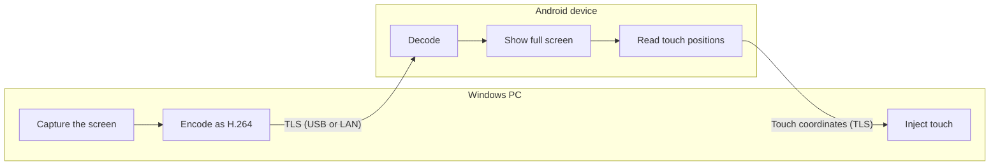
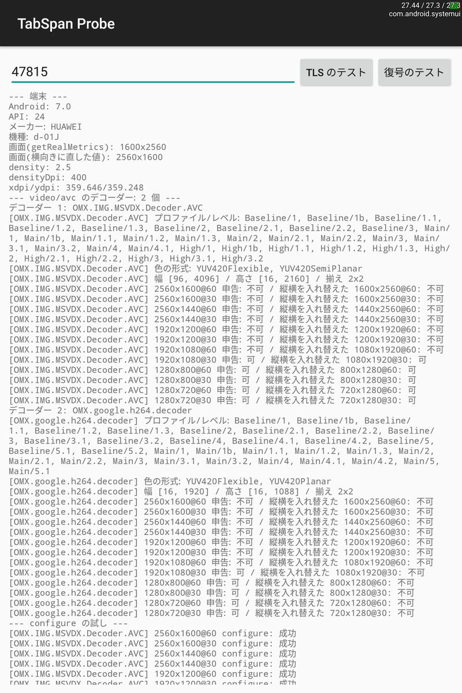

# TabSpan

Software to turn an Android device into an extended monitor for a Windows PC (work in progress).

English | [日本語](README.md)

> [!IMPORTANT]
> **Work in progress. For now it can mirror one PC monitor to a device over USB.**
> Touch, extending the desktop (virtual display) and LAN are not there yet.

## Contents

- [What it will be](#what-it-will-be)
- [Status](#status)
- [What the measurements showed](#what-the-measurements-showed)
- [Screenshot](#screenshot)
- [Trying the app (v0.1.0)](#trying-the-app-v010)
- [Getting started](#getting-started)
- [Using the probes](#using-the-probes)
- [Building from source](#building-from-source)
- [Safety and privacy](#safety-and-privacy)
- [Manual](#manual)
- [License](#license)

## What it will be

The PC side (a C# / .NET 10 tray app) captures a screen, encodes it as H.264 and sends it. The Android side (Kotlin) decodes it and shows it full screen, and sends touch positions back to the PC. It connects over USB (adb port forwarding) or LAN, wrapped in TLS either way.



Design rules:

- No display driver is written, installed or reconfigured. You pick a virtual display you installed yourself as the screen to send. Picking a real monitor works as a mirror with no driver at all.
- The PC side never runs as administrator.
- All traffic is TLS, even over USB, and only paired devices get through. The first pairing must happen over USB.
- Video, touch coordinates and screen contents are never stored. Nothing is sent anywhere except the paired device.

## Status

The latest release is [v0.1.0](https://github.com/takosasi-dev/tab-span/releases/tag/v0.1.0) (pre-release). It can mirror one PC monitor to a device over USB. The only device it has been checked on is a dtab d-01J (Android 7.0).

| Phase | What | State |
|---|---|---|
| 0 | Measurements and baseline (probes) | Partly done (breakdown below) |
| 1 | Connection: TLS, pairing, device list, adb reverse | Implemented. Pairing and connecting worked on a dtab d-01J |
| 2 | Video over USB: capture, encode, send, decode and show on the device | Partly done. Mirroring a real monitor showed up on a dtab d-01J. Virtual display (extending) still to do. No hardware encoder works on the PC yet, so it encodes in software |
| 3 | Touch | To do |
| 4 | LAN, discovery, detaching and attaching the virtual display | To do |
| 5 | Tray app and finished screens: tray, settings, diagnostics, single instance, start with Windows, English UI | To do (the current PC window is a stopgap, Japanese only) |
| 6 | Release package and measurements | To do |

Phase 0 breakdown:

| Phase 0 item | State |
|---|---|
| Write the PC probe `TabSpan.Probe` | Done |
| Write the Android probe app | Done |
| Monitor list (`monitors`) and screen capture (`capture`) | Done (run) |
| H.264 encoder list (`encoders`) | Done (run) |
| Encoding (`encode`) with a software encoder | Done (run) |
| Encoding (`encode`) with a hardware encoder | To do (not working yet) |
| adb check (`adb`) | Done (run) |
| TLS from the device to the PC (`tls` and the device's "TLS のテスト") | Done (connected) |
| Device decoder survey and decode test | Done (run on a dtab d-01J) |
| Detaching and attaching monitors (`detach` / `attach`) | To do |
| Touch injection (`touch`) | To do |
| Measuring latency by photographing `clock` | To do |
| Trying a virtual display | To do |
| Comparison with spacedesk | To do |

## What the measurements showed

The device is a dtab d-01J (Android 7.0).

- **Delay when mirroring with the app**: at 1920x1080@30, the median delay from capture on the PC to the frame being decoded on the device was about 16 ms, with no dropped frames (software encoder on the PC). This does not include the time until the picture appears on the device's screen. If you choose 60 fps, it scales the video down to 1280x720 to stay within what the device's decoder reports (1280x800).
- **TLS**: the device connected to the PC's `tls` over USB (`adb reverse`) with TLS 1.2 (ECDHE-ECDSA, AES-256-GCM).
- **Decoding**: the device's hardware decoder (`OMX.IMG.MSVDX.Decoder.AVC`) decoded every size tried, 1280x720 to 2560x1600 at 30 fps and 60 fps, faster than real time. That includes sizes the decoder itself reports as unsupported (1920x1080@60, 1920x1200, 2560x1440, 2560x1600).
- **Software decoder**: `OMX.google.h264.decoder` managed about 48 fps at 2560x1600, with a delay of 90 to 200 ms.
- **PC encoding**: no hardware encoder has worked yet. The software encoder took about 2.5 ms per frame at 1920x1080.

Hardware decoder results (decoding to a Surface; synthetic video at 8 Mbps):

| Size | 30 fps: speed | 30 fps: delay | 60 fps: speed | 60 fps: delay |
|---|---:|---:|---:|---:|
| 1280x720 | 457 fps | 5.8 ms | 483 fps | 6.0 ms |
| 1280x800 | 425 fps | 7.8 ms | 443 fps | 7.3 ms |
| 1920x1080 | 223 fps | 10.7 ms | 230 fps | 9.8 ms |
| 1920x1200 | 203 fps | 10.9 ms | 209 fps | 10.2 ms |
| 2560x1440 | 125 fps | 17.0 ms | 128 fps | 12.4 ms |
| 2560x1600 | 115 fps | 14.4 ms | 116 fps | 13.4 ms |

- Speed: frames per second out when fed as fast as possible.
- Delay: median time from feeding a frame to getting the picture, when fed at real-time intervals.

These are results from one device with synthetic video. Other devices, or real desktop content, will differ.

## Screenshot

The Android probe open on a dtab d-01J. When it starts, it surveys the device and its decoders on its own.



## Trying the app (v0.1.0)

It mirrors one PC monitor to a device connected by USB. Touch, extending and LAN are not there yet.

> [!WARNING]
> The PC window (`TabSpan.App`) is a stopgap, and even the author has not launched it to check it yet. What has been checked is how its parts fit together, and video through the windowless `TabSpan.Probe serve`, which runs the same parts ([below](#trying-it-without-a-window-tabspanprobe-serve)).

The PC window is in Japanese only. The device app shows English or Japanese depending on the device language. Labels below are given as they appear on screen, with a translation where needed.

### What you need

- A Windows 11 (x64) PC and the .NET 10 SDK. The PC side is not distributed as a binary, because the redistribution terms of the Windows SDK DLLs that ship next to the exe have not been checked yet.
- adb, on PATH or installed with winget (`winget install Google.PlatformTools`). After PATH, TabSpan looks in winget's default location, `%LOCALAPPDATA%\Microsoft\WinGet\Packages\Google.PlatformTools_*\platform-tools\adb.exe`.
- An Android 7.0 or later device with USB debugging turned on in the developer options.

### Install

1. Build the PC side.

   ```powershell
   dotnet build pc\TabSpan.sln -c Release
   ```

   This produces `pc\src\TabSpan.App\bin\Release\net10.0-windows10.0.22621.0\win-x64\TabSpan.App.exe`.
2. Download `TabSpan-v0.1.0-android.apk` from the [v0.1.0 release](https://github.com/takosasi-dev/tab-span/releases/tag/v0.1.0) and install it on the device (`adb install TabSpan-v0.1.0-android.apk`). Use the same version on the PC and the device.

> [!NOTE]
> This APK is also **a temporary build signed with a debug key**. Once it moves to the real key you will need to uninstall it and install again.

### First connection

1. Connect the device to the PC by USB. If the device asks whether to allow USB debugging, allow it.
2. Start `TabSpan.App.exe` on the PC. It does not need administrator rights.
3. In the "映す画面" (screen to show) list, pick the monitor to mirror.
4. Press "端末を追加" (add device). A window opens and waits for the device.
5. Open TabSpan on the device and press "Add PC" ("PC を追加").
6. A 6-digit number appears on both the PC and the device. If they match, press "許可" (allow) on the PC.
7. The device connects to the PC on its own and shows the monitor you picked.

After that, with the device on USB and TabSpan running on the PC, opening TabSpan on the device is enough: it connects on its own.

### Stopping

- On the device, press Back or switch away from TabSpan to disconnect.
- On the PC, "切断" (disconnect) ends the current connection. Closing the TabSpan window on the PC quits it (it tells the device it is quitting and removes the adb reverse first).

### Where data is kept

| Place | Contents |
|---|---|
| `%APPDATA%\TabSpan` | Settings (`settings.json`), the PC's identity key (`identity.bin`, protected with Windows DPAPI so only that user can read it), and the list of paired devices (`devices.json`) |
| `%LOCALAPPDATA%\TabSpan\logs` | Logs (`tabspan-<date>.log`, switched to a new file at 5 MB; files older than 14 days are removed at startup) |
| The TabSpan app's private storage on the device | The device's identifier and the paired PCs |

To pair again, clear TabSpan's app data in the device settings and go through "First connection" again (there is no screen on the device to remove a PC yet).

### Trying it without a window (`TabSpan.Probe serve`)

`TabSpan.Probe.exe serve` runs the same parts as the app, without a window, and listens and mirrors. It uses the same data locations as the app.

```powershell
# First time: accept pairing for 120 seconds
TabSpan.Probe.exe serve --pair
# After that
TabSpan.Probe.exe serve
```

With `--pair`, pressing "Add PC" on the device prints `PAIRING CODE <6 digits>`. Type the 6 digits shown on the device into standard input; it allows the device only if they match. You can also pass them up front with `--approve-code <6 digits>`. Other options: `--monitor <id>` (the monitor to mirror; a `DeviceName` printed by `monitors`), `--fps 30|60`, `--bitrate <Mbps>`, `--seconds <N>`, `--software` (software encoder only) and `--no-adb` (you set up adb reverse yourself). Press Ctrl+C or `q` to stop.

## Getting started

From here on, this is about the measurement tools (Phase 0 probes) used to settle the design.

### Install the Android probe

Android 7.0 or later.

1. Download `TabSpan-Probe-v0.1.0-android.apk` from the [v0.1.0 release](https://github.com/takosasi-dev/tab-span/releases/tag/v0.1.0) (the probe has not changed since v0.0.2).
2. Install it. From the PC: `adb install TabSpan-Probe-v0.1.0-android.apk`. To open it on the device directly, you need to allow installing apps from unknown sources (where that setting is depends on the device).
3. Open "TabSpan Probe" on the device. The survey starts on its own and ends with `--- 終わり ---` ("end").

> [!NOTE]
> The APK is **a temporary build signed with a debug key**. Once it moves to the real key you will need to uninstall it and install again.

### Get the PC probe

The PC probe is not distributed as a binary, because the redistribution terms of the Windows SDK DLLs that ship next to the exe have not been checked yet. [Build it from source](#building-from-source).

## Using the probes

The probes' output is in Japanese. The quoted labels below are what you will see on screen.

### PC probe (`TabSpan.Probe.exe`)

Run it from a non-elevated PowerShell. Run it with no arguments to see the usage. `<id>` is a `DeviceName` printed by `monitors` (for example `\\.\DISPLAY2`).

| Subcommand | What it does | Caution |
|---|---|---|
| `monitors` | Lists monitors (name, id, size, position, attached or not, primary or not) | |
| `capture <id>` | Captures that monitor for 5 seconds and reports frame count, size, and whether the cursor and border settings took effect | Captured images are not saved |
| `encoders` | Lists H.264 encoders and the properties they support | |
| `encode <id>` | Captures and encodes for 5 seconds and reports frames, key frames, bytes and encode time | Neither images nor encoded data are saved |
| `detach <id>` | Removes that monitor from the desktop | **The screen goes away.** Asks first |
| `attach <id> [x y width height]` | Puts a detached monitor back on the desktop | **Changes your display layout.** Asks first |
| `touch <x> <y>` | Taps that point once, then tries a 3-second long press four times | **Whatever is at that point really gets pressed.** Asks first |
| `adb` | Shows where adb is, its version and connected devices (serials masked) | May start the adb server |
| `clock` | Shows a millisecond clock window (for measuring latency by photo) | **Opens a window.** Close it to finish |
| `tls <port>` | Opens a TLS listener on 127.0.0.1 for 60 seconds (for a connection test from the device) | Listens on 127.0.0.1 only |

`detach`, `attach`, `touch` and `clock` make real changes to your screen or input. Read the matching part of the [manual](#manual) before running them.

### Android probe

| Control | What it does |
|---|---|
| Opening the app | Shows device info, screen size, the `video/avc` decoders, and for each candidate size what the decoder reports and whether configure succeeds |
| Port field | The port the TLS test connects to (47815 by default) |
| "TLS のテスト" (TLS test) | Connects to that port on 127.0.0.1 with TLS 1.2 and shows the result and the peer certificate fingerprint |
| "復号のテスト" (decode test) | Decodes the H.264 files you placed with each decoder and measures speed and delay |

Every line also goes to logcat (tag `TabSpanProbe`). On the PC, `adb logcat -s TabSpanProbe` shows them.

You can also start the tests from adb:

```powershell
# TLS test (port 47815)
adb shell am start -n io.github.takosasidev.tabspan.probe/.MainActivity --es action tls --ei port 47815
# Decode test
adb shell am start -n io.github.takosasidev.tabspan.probe/.MainActivity --es action decode-test
```

### TLS test

1. On the PC, run `TabSpan.Probe.exe tls 47815`. It prints the certificate's SHA-256 fingerprint and listens for 60 seconds.
2. In another PowerShell, run `adb reverse tcp:47815 tcp:47815`. The device's 127.0.0.1:47815 now reaches the PC.
3. Within those 60 seconds, tap "TLS のテスト" in the app. The app runs its jobs one at a time, so if the startup survey or a decode test is still running, wait for `--- 終わり ---` first (best done before step 1).
4. Check that the fingerprint on the PC (`証明書の SHA-256 の指紋`) matches the one on the device (`相手の証明書の SHA-256 の指紋`). Both are upper-case hex with no separators.

Example output (an example; the fingerprint is made up):

```text
PC:     証明書の SHA-256 の指紋: 0A1B2C3D4E5F60718293A4B5C6D7E8F90A1B2C3D4E5F60718293A4B5C6D7E8F9
PC:     接続 1 (12 秒後): TLS の版 = Tls12、暗号スイート = TLS_ECDHE_ECDSA_WITH_AES_256_GCM_SHA384
Device: TLS の結果: 成功
Device: 相手の証明書の SHA-256 の指紋: 0A1B2C3D4E5F60718293A4B5C6D7E8F90A1B2C3D4E5F60718293A4B5C6D7E8F9
```

### Decode test

1. Tap "復号のテスト" once in the app. The `置き場:` (location) line shows the folder to put videos in. It looks like `/storage/emulated/0/Android/data/io.github.takosasidev.tabspan.probe/files`; from adb, `/sdcard/Android/data/io.github.takosasidev.tabspan.probe/files` is the same place.
2. Make the videos on the PC. They must be raw H.264 (Annex B) with an AUD at the start of each frame, named `tabspan_<width>x<height>_<fps>.h264`. With ffmpeg:

   ```powershell
   ffmpeg -f lavfi -i testsrc2=size=1280x800:rate=30 -t 5 -c:v libx264 -profile:v main -bf 0 -g 60 -b:v 8M -x264-params aud=1 -f h264 tabspan_1280x800_30.h264
   ```

3. Put them in that folder: `adb push tabspan_1280x800_30.h264 /sdcard/Android/data/io.github.takosasidev.tabspan.probe/files/`
4. Tap "復号のテスト" again. It measures speed and delay for each decoder and prints a table at the end. This can take a few minutes (each measurement gives up after 20 seconds).

Reading the table cells:

| Cell | Meaning |
|---|---|
| `425.0fps/7.8ms` | Speed / median delay |
| Ends with `BB` | Could not decode to a Surface, so it was measured with ByteBuffer output |
| Ends with `(140/150枚)` | Fewer pictures came out than were fed in |
| `時間切れ 0/150枚` (timed out) and similar | Could not be measured (reason, and pictures out) |

The `R-4(1280x800@30 を復号できるか)` line under the table says whether any decoder decoded every frame of the 1280x800@30 video at 30 fps or faster. Without `tabspan_1280x800_30.h264` it says it cannot decide (`判定できない`).

## Building from source

### PC (app and probe)

- Windows 11 (x64)
- .NET 10 SDK
- The Windows SDK reference comes automatically with the project's target framework (`net10.0-windows10.0.22621.0`). Nothing else to install.

```powershell
dotnet build pc\TabSpan.sln -c Release
```

The exes end up at `pc\src\TabSpan.App\bin\Release\net10.0-windows10.0.22621.0\win-x64\TabSpan.App.exe` and `pc\src\TabSpan.Probe\bin\Release\net10.0-windows10.0.22621.0\win-x64\TabSpan.Probe.exe`.

### Android (app and probe)

- JDK 17
- Android SDK (compileSdk 35)
- Put the SDK location in `android\local.properties` (this file is not committed).

```properties
sdk.dir=C\:\\Android\\Sdk
```

```powershell
cd android
.\gradlew.bat assembleDebug
```

The APKs end up at `android\app\build\outputs\apk\debug\app-debug.apk` (the app) and `android\probe\build\outputs\apk\debug\probe-debug.apk` (the probe).

## Safety and privacy

### The app (App, `serve` and TabSpan on the device)

- **Video is not saved**: captured screens and encoded video are not written to files.
- **What it keeps**: settings, the PC's identity key, the list of paired devices, and logs ([where](#where-data-is-kept)). The identity key is protected with Windows DPAPI so only that user can read it. Logs are designed not to contain video, touch coordinates, tokens or private keys.
- **Nothing goes out**: the PC listens only on 127.0.0.1 (port 47815 by default). The device reaches it over USB (adb reverse) and connects with TLS. The device app's only permission is INTERNET.
- **Pairing**: only accepted from a device connected by USB. Only a device whose 6-digit number matches the one on the PC, and that you allow on the PC, is added to the list.

### Measurement tools (probes)

- **Nothing is saved**: captured screens, encoded video and results are not written to files (`serve` follows the app's rules above). Results only go to the console and the device screen (and logcat). The key for the `tls` certificate is placed in your Windows user key store for a short time and removed when the probe is done with it.
- **Nothing goes out**: the PC's `tls` listens only on 127.0.0.1, and the device app only connects to 127.0.0.1. The device app's only permission is INTERNET.
- **The TLS test does not validate the certificate** (probe only). Confirm that the peer really is your PC by comparing the fingerprints shown on both sides.
- **`detach` can remove a real monitor too.** Before detaching it prints a command that puts the monitor back at the same position and size. Note it down before pressing `y`. It refuses the primary monitor and the last attached monitor.
- **The output contains details of your PC**, such as monitor and adapter names and device IDs. Do not paste it in public places as is.

## Manual

A user manual (PDF, Japanese only) covering both the PC and the device, with steps and screenshots, is attached to the [Releases](https://github.com/takosasi-dev/tab-span/releases). Its source is in [`docs/manual/`](docs/manual/).

## License

MIT ([LICENSE](LICENSE)). Third-party licenses are listed in [THIRD-PARTY-NOTICES.md](THIRD-PARTY-NOTICES.md).
