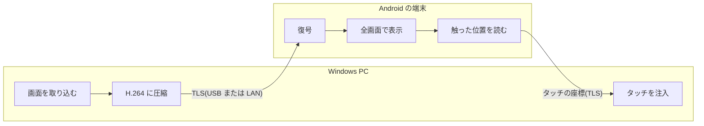
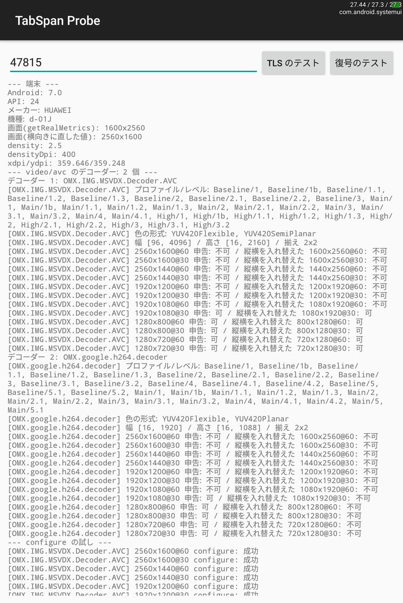

# TabSpan

Android の端末を、Windows PC の拡張モニターにするソフト(開発中)。

[English](README.en.md) | 日本語

> [!IMPORTANT]
> **開発中です。いまは PC の 1 枚のモニターを、USB で端末に複製して映せるところまでです。**
> タッチ・拡張(仮想ディスプレイ)・LAN は、まだありません。

## 目次

- [作ろうとしている物](#作ろうとしている物)
- [いまの状況](#いまの状況)
- [測定でわかったこと](#測定でわかったこと)
- [画面](#画面)
- [本体を試す(v0.1.0)](#本体を試すv010)
- [はじめ方](#はじめ方)
- [測定用ツールの使い方](#測定用ツールの使い方)
- [ソースからビルド](#ソースからビルド)
- [安全とプライバシー](#安全とプライバシー)
- [取扱説明書](#取扱説明書)
- [ライセンス](#ライセンス)

## 作ろうとしている物

PC 側(C# / .NET 10 の常駐アプリ)が画面を取り込み、H.264 に圧縮して送ります。Android 側(Kotlin)が復号して全画面で映し、触った位置を PC に返します。つなぎ方は USB(adb の転送)と LAN で、どちらも TLS で包みます。



設計で守ること:

- 仮想ディスプレイのドライバを作りません。入れることも、設定を書き換えることもしません。利用者が別に入れた仮想ディスプレイを「映す画面」として選ぶだけです。実在のモニターを選べば、ドライバなしで複製として動きます。
- PC 側は管理者の権限で動かしません。
- 通信は USB でも TLS で、ペアリングした端末だけを通します。初回のペアリングは USB に限ります。
- 映像・タッチの座標・画面の内容を保存しません。ペアリングした端末のほかへ通信しません。

## いまの状況

最新は [v0.1.0](https://github.com/takosasi-dev/tab-span/releases/tag/v0.1.0)(プレリリース)です。PC の 1 枚のモニターを、USB で端末に複製して映せます。確かめた端末は dtab d-01J(Android 7.0)だけです。

| Phase | 中身 | 状態 |
|---|---|---|
| 0 | 測定と基準取り(Probe) | 一部済み(下の内訳) |
| 1 | 接続: TLS・ペアリング・端末の台帳・adb の reverse | 実装済み。dtab d-01J でペアリングと接続が通った |
| 2 | 映像(USB): 取り込み・圧縮・送信・端末での復号と表示 | 一部済み。実在のモニターの複製は dtab d-01J で映った。仮想ディスプレイ(拡張)はこれから。PC のハードウェアのエンコーダーはまだ通らず、ソフトウェアで圧縮している |
| 3 | タッチ | これから |
| 4 | LAN・探索・仮想ディスプレイの取り外しと取り付け | これから |
| 5 | 常駐と画面の仕上げ: トレイ・設定・診断・多重起動の防止・自動起動・英語の画面 | これから(いまの PC の画面は仮の物で、日本語だけ) |
| 6 | 公開の一式と測定 | これから |

Phase 0 の内訳:

| Phase 0 の中身 | 状態 |
|---|---|
| PC の測定用ツール `TabSpan.Probe` を作る | 済み |
| Android の測定用アプリ(probe)を作る | 済み |
| モニターの一覧(`monitors`)・画面の取り込み(`capture`) | 済み(実行した) |
| H.264 のエンコーダーの一覧(`encoders`) | 済み(実行した) |
| 圧縮(`encode`)のソフトウェアのエンコーダー | 済み(実行した) |
| 圧縮(`encode`)のハードウェアのエンコーダー | これから(まだ通っていない) |
| adb の確認(`adb`) | 済み(実行した) |
| 端末から PC への TLS の接続(`tls` と端末の「TLS のテスト」) | 済み(つながった) |
| 端末のデコーダーの調べ物と復号のテスト | 済み(dtab d-01J で実行した) |
| モニターの取り外し・取り付け(`detach` / `attach`) | これから |
| タッチの注入(`touch`) | これから |
| 時計(`clock`)を撮影して遅延を測る | これから |
| 仮想ディスプレイでの試し | これから |
| spacedesk との比べ | これから |

## 測定でわかったこと

端末は dtab d-01J(Android 7.0)です。

- **本体で映したときの遅れ**: 1920x1080@30 で、PC で取り込んでから端末で復号されるまでの遅れの中央値は約 16 ms、捨てたフレームは 0 でした(PC はソフトウェアのエンコーダー)。端末の画面に絵が出るまでの時間は含みません。60 fps を選ぶと、端末のデコーダーが申告する範囲(1280x800)に収めるため、1280x720 に縮めて送ります。
- **TLS**: 端末から USB(`adb reverse`)経由で PC の `tls` へ、TLS 1.2(ECDHE-ECDSA、AES-256-GCM)でつながりました。
- **復号**: 端末のハードウェアのデコーダー(`OMX.IMG.MSVDX.Decoder.AVC`)は、試した 1280x720〜2560x1600 の 30 fps と 60 fps を全部、実時間より速く復号できました。デコーダー自身の申告では「不可」だった大きさ(1920x1080@60、1920x1200、2560x1440、2560x1600)も含みます。
- **ソフトウェアのデコーダー**: `OMX.google.h264.decoder` は 2560x1600 で約 48 fps、遅れは 90〜200 ms でした。
- **PC の圧縮**: ハードウェアのエンコーダーは、まだ通っていません。ソフトウェアのエンコーダーでは、1920x1080 で 1 枚あたり約 2.5 ms でした。

ハードウェアのデコーダーの実測(Surface へ復号。合成の映像・8 Mbps):

| 大きさ | 30 fps: 速さ | 30 fps: 遅れ | 60 fps: 速さ | 60 fps: 遅れ |
|---|---:|---:|---:|---:|
| 1280x720 | 457 fps | 5.8 ms | 483 fps | 6.0 ms |
| 1280x800 | 425 fps | 7.8 ms | 443 fps | 7.3 ms |
| 1920x1080 | 223 fps | 10.7 ms | 230 fps | 9.8 ms |
| 1920x1200 | 203 fps | 10.9 ms | 209 fps | 10.2 ms |
| 2560x1440 | 125 fps | 17.0 ms | 128 fps | 12.4 ms |
| 2560x1600 | 115 fps | 14.4 ms | 116 fps | 13.4 ms |

- 速さ: できるだけ速く入れたときに、1 秒あたり何枚出たか。
- 遅れ: 実時間の間隔で入れたときに、1 枚を入れてから絵が出るまでの時間の中央値。

1 台の端末・合成の映像での結果です。ほかの端末や、実際のデスクトップの映像では変わります。

## 画面

Android の probe を dtab d-01J で開いたところです。起動すると、端末とデコーダーの調べ物が自動で始まります。



## 本体を試す(v0.1.0)

PC の 1 枚のモニターを、USB でつないだ端末に複製して映します。タッチ・拡張・LAN はまだありません。

> [!WARNING]
> PC 側の画面(`TabSpan.App`)は仮の物で、作者の手元でもまだ起動して確かめていません。部品の組み立てと、同じ部品で動く窓なしの `TabSpan.Probe serve` での映像は確かめました([下](#窓を出さずに試すtabspanprobe-serve))。

### 用意する物

- Windows 11(x64)の PC と、.NET 10 SDK(PC 側はビルド済みの物を配っていません。exe の隣に入る Windows SDK の DLL の再配布の条件を、まだ確かめ終えていないためです)
- adb。PATH に通すか、winget で入れます(`winget install Google.PlatformTools`)。TabSpan は PATH の次に、winget の既定の場所 `%LOCALAPPDATA%\Microsoft\WinGet\Packages\Google.PlatformTools_*\platform-tools\adb.exe` を探します。
- Android 7.0 以上の端末。開発者向けオプションで USB デバッグをオンにしておきます。

### 入れる

1. PC 側をビルドします。

   ```powershell
   dotnet build pc\TabSpan.sln -c Release
   ```

   `pc\src\TabSpan.App\bin\Release\net10.0-windows10.0.22621.0\win-x64\TabSpan.App.exe` が出ます。
2. [v0.1.0 の Release](https://github.com/takosasi-dev/tab-span/releases/tag/v0.1.0) から `TabSpan-v0.1.0-android.apk` を取り、端末に入れます(`adb install TabSpan-v0.1.0-android.apk`)。PC 側と端末側は同じ版にします。

> [!NOTE]
> この APK も **debug の鍵で署名した仮の物** です。正式な鍵に変えた後は、いったん消して入れ直す必要があります。

### 初めてつなぐ

1. 端末を USB で PC につなぎます。端末に「USB デバッグを許可しますか」が出たら「許可」を押します。
2. PC で `TabSpan.App.exe` を起動します。管理者で動かす必要はありません。
3. 「映す画面」の一覧から、映すモニターを選びます。
4. 「端末を追加」を押します。端末からの要求を待つ窓が開きます。
5. 端末で TabSpan を開き、「PC を追加」を押します。
6. PC と端末の両方に 6 桁の番号が出ます。同じなら、PC で「許可」を押します。
7. 端末が自動で PC につながり、選んだモニターが映ります。

2 回目からは、USB でつないで PC の TabSpan を起動しておけば、端末で TabSpan を開くだけで自動でつながります。

### 止める

- 端末で戻るボタンを押すか、TabSpan を裏に回すと切れます。
- PC で「切断」を押すと、いまの接続を切ります。PC の TabSpan の窓を閉じると終わります(端末に終わりを知らせ、adb の reverse を外してから終わります)。

### データの置き場

| 場所 | 中身 |
|---|---|
| `%APPDATA%\TabSpan` | 設定(`settings.json`)、PC の識別の鍵(`identity.bin`。Windows の DPAPI で、その利用者だけが読めるように守る)、ペアリングした端末の台帳(`devices.json`) |
| `%LOCALAPPDATA%\TabSpan\logs` | ログ(`tabspan-<日付>.log`。1 ファイル 5 MB で切り替え、14 日より古い物は起動時に消す) |
| 端末の TabSpan のアプリの専用領域 | 端末の識別子と、ペアリングした PC の情報 |

ペアリングをやり直したいときは、端末の設定で TabSpan のアプリのデータを消してから、「初めてつなぐ」の手順をもう一度行います(いまは端末側に PC を消す画面がありません)。

### 窓を出さずに試す(`TabSpan.Probe serve`)

`TabSpan.Probe.exe serve` は、App と同じ部品で、窓を出さずに待ち受けて映します。データの置き場も App と同じです。

```powershell
# 初回: ペアリングの受け付けを 120 秒開く
TabSpan.Probe.exe serve --pair
# 2 回目から
TabSpan.Probe.exe serve
```

`--pair` を付けると、端末で「PC を追加」を押したときに `PAIRING CODE <6 桁>` が出ます。端末に出ている 6 桁を標準入力に打つと、同じ番号のときだけ許可します。`--approve-code <6 桁>` で先に渡すこともできます。ほかに `--monitor <識別子>`(映すモニター。`monitors` が出す `DeviceName`)、`--fps 30|60`、`--bitrate <Mbps>`、`--seconds <N>`、`--software`(ソフトウェアのエンコーダーだけを使う)、`--no-adb`(adb の reverse を自分で張る)があります。Ctrl+C か `q` で終わります。

## はじめ方

ここからは、設計を決めるための測定用ツール(Phase 0 の Probe)の話です。

### Android の probe を入れる

対象は Android 7.0 以上です。

1. [v0.1.0 の Release](https://github.com/takosasi-dev/tab-span/releases/tag/v0.1.0) から `TabSpan-Probe-v0.1.0-android.apk` を取ります(probe は v0.0.2 から変えていません)。
2. 端末に入れます。PC から入れるなら `adb install TabSpan-Probe-v0.1.0-android.apk`。端末で直接開く場合は、提供元の不明なアプリを許す設定が要ります(場所は機種で違います)。
3. 端末で「TabSpan Probe」を開きます。調べ物が自動で始まり、最後に `--- 終わり ---` が出ます。

> [!NOTE]
> この APK は **debug の鍵で署名した仮の物** です。正式な鍵に変えた後は、いったん消して入れ直す必要があります。

### PC の Probe を用意する

PC の Probe はビルド済みの物を配っていません。exe の隣に入る Windows SDK の DLL の再配布の条件を、まだ確かめ終えていないためです。[ソースからビルド](#ソースからビルド)してください。

## 測定用ツールの使い方

### PC の Probe(`TabSpan.Probe.exe`)

管理者でない PowerShell から動かします。引数なしで動かすと使い方が出ます。`<識別子>` は `monitors` が出す `DeviceName`(例: `\\.\DISPLAY2`)です。

| サブコマンド | やること | 注意 |
|---|---|---|
| `monitors` | モニターの一覧(名前・識別子・大きさ・位置・付いているか・主モニターか) | |
| `capture <識別子>` | そのモニターを 5 秒取り込み、届いたフレームの数・大きさ・カーソルと枠の設定が通ったかを出す | 取り込んだ絵は保存しない |
| `encoders` | H.264 のエンコーダーの一覧と、使えるプロパティを出す | |
| `encode <識別子>` | 5 秒取り込んで圧縮し、フレームの数・キーフレームの数・バイト数・圧縮の時間を出す | 絵も圧縮した中身も保存しない |
| `detach <識別子>` | そのモニターをデスクトップから外す | **画面が消える**。確認あり |
| `attach <識別子> [x y 幅 高さ]` | 外したモニターをデスクトップに付ける | **画面の構成が変わる**。確認あり |
| `touch <x> <y>` | その位置を 1 回タップし、3 秒の長押しを 4 回試す | **その位置の物が本当に押される**。確認あり |
| `adb` | adb の場所・版・つながっている端末を出す(シリアルは伏せる) | adb のサーバーを起こすことがある |
| `clock` | ミリ秒まで出る時計のウィンドウを出す(撮影で遅延を測るため) | **ウィンドウが開く**。閉じると終わる |
| `tls <port>` | 127.0.0.1 に TLS の待ち受けを 60 秒開く(端末からの接続テスト用) | 127.0.0.1 だけで待ち受ける |

`detach`・`attach`・`touch`・`clock` は、画面や入力に実際の変化を起こします。動かす前に、[取扱説明書](#取扱説明書)の該当の節を読んでください。

### Android の probe

| 操作 | やること |
|---|---|
| 開く | 端末の情報・画面の大きさ・`video/avc` のデコーダーの一覧と、候補の大きさごとの申告と configure の試しを出す |
| ポートの欄 | TLS のテストでつなぐポート(既定は 47815) |
| 「TLS のテスト」 | 127.0.0.1 のそのポートへ TLS 1.2 でつなぎ、結果と相手の証明書の指紋を出す |
| 「復号のテスト」 | 置いた H.264 の映像を、デコーダーごとに復号して速さと遅れを測る |

出た行は logcat(タグ `TabSpanProbe`)にも出ます。PC で `adb logcat -s TabSpanProbe` と打つと読めます。

adb から始めることもできます。

```powershell
# TLS のテスト(ポート 47815)
adb shell am start -n io.github.takosasidev.tabspan.probe/.MainActivity --es action tls --ei port 47815
# 復号のテスト
adb shell am start -n io.github.takosasidev.tabspan.probe/.MainActivity --es action decode-test
```

### TLS のテスト

1. PC で `TabSpan.Probe.exe tls 47815` を動かします。証明書の SHA-256 の指紋が出て、60 秒待ち受けます。
2. 別の PowerShell で `adb reverse tcp:47815 tcp:47815` を打ちます。端末の 127.0.0.1:47815 が PC へつながります。
3. 60 秒のうちに、端末のアプリで「TLS のテスト」を押します。アプリの仕事は順番に並ぶので、起動の調べ物や復号のテストの途中なら、`--- 終わり ---` が出てから押します(手順 1 より前に済ませておくと確実です)。
4. PC の「証明書の SHA-256 の指紋」と、端末の「相手の証明書の SHA-256 の指紋」が同じか見比べます(どちらも大文字の 16 進、区切りなし)。

出力の例(例です。指紋は架空の値):

```text
PC:   証明書の SHA-256 の指紋: 0A1B2C3D4E5F60718293A4B5C6D7E8F90A1B2C3D4E5F60718293A4B5C6D7E8F9
PC:   接続 1 (12 秒後): TLS の版 = Tls12、暗号スイート = TLS_ECDHE_ECDSA_WITH_AES_256_GCM_SHA384
端末: TLS の結果: 成功
端末: 相手の証明書の SHA-256 の指紋: 0A1B2C3D4E5F60718293A4B5C6D7E8F90A1B2C3D4E5F60718293A4B5C6D7E8F9
```

### 復号のテスト

1. 端末のアプリで、一度「復号のテスト」を押します。出力の `置き場:` の行に、映像を置くフォルダが出ます。`/storage/emulated/0/Android/data/io.github.takosasidev.tabspan.probe/files` のような形で、adb からは `/sdcard/Android/data/io.github.takosasidev.tabspan.probe/files` が同じ場所です。
2. PC で試したい映像を作ります。生の H.264(Annex B)で、各フレームの先頭に AUD が要ります。名前は `tabspan_<幅>x<高さ>_<fps>.h264` です。ffmpeg の例:

   ```powershell
   ffmpeg -f lavfi -i testsrc2=size=1280x800:rate=30 -t 5 -c:v libx264 -profile:v main -bf 0 -g 60 -b:v 8M -x264-params aud=1 -f h264 tabspan_1280x800_30.h264
   ```

3. 端末のフォルダへ置きます: `adb push tabspan_1280x800_30.h264 /sdcard/Android/data/io.github.takosasidev.tabspan.probe/files/`
4. もう一度「復号のテスト」を押します。デコーダーごとに速さと遅れを測り、最後に表が出ます。数分かかることがあります(測定 1 回ごとに 20 秒で打ち切ります)。

表のマスの読み方:

| マスの形 | 意味 |
|---|---|
| `425.0fps/7.8ms` | 速さ / 遅れの中央値 |
| 末尾に `BB` | Surface へ復号できず、ByteBuffer の出力で測った |
| 末尾に `(140/150枚)` | 入れた数より出た絵が少なかった |
| `時間切れ 0/150枚` など | 測れなかった(理由と、出た枚数) |

表の下に出る `R-4(1280x800@30 を復号できるか)` の行は、1280x800@30 の映像を、どれかのデコーダーで全部の枚数、30 fps 以上の速さで復号できたかの判定です。`tabspan_1280x800_30.h264` を置いていなければ「判定できない」と出ます。

## ソースからビルド

### PC(App と Probe)

- Windows 11(x64)
- .NET 10 SDK
- Windows SDK の参照は、プロジェクトの対象(`net10.0-windows10.0.22621.0`)から .NET SDK が自動で取ります。別に入れる物はありません。

```powershell
dotnet build pc\TabSpan.sln -c Release
```

exe は `pc\src\TabSpan.App\bin\Release\net10.0-windows10.0.22621.0\win-x64\TabSpan.App.exe` と `pc\src\TabSpan.Probe\bin\Release\net10.0-windows10.0.22621.0\win-x64\TabSpan.Probe.exe` に出ます。

### Android(本体と probe)

- JDK 17
- Android SDK(compileSdk 35)
- `android\local.properties` に SDK の場所を書きます(このファイルはリポジトリに入れません)。

```properties
sdk.dir=C\:\\Android\\Sdk
```

```powershell
cd android
.\gradlew.bat assembleDebug
```

APK は `android\app\build\outputs\apk\debug\app-debug.apk`(本体)と `android\probe\build\outputs\apk\debug\probe-debug.apk`(probe)に出ます。

## 安全とプライバシー

### 本体(App・`serve`・端末の TabSpan)

- **映像を保存しない**: 取り込んだ画面と圧縮した映像はファイルに書きません。
- **残す物**: 設定・PC の識別の鍵・ペアリングした端末の台帳と、ログを残します([データの置き場](#データの置き場))。識別の鍵は Windows の DPAPI で、その利用者だけが読めるように守ります。ログには映像・タッチの座標・トークン・秘密鍵を書かない作りです。
- **外へ通信しない**: PC は 127.0.0.1 だけで待ち受けます(既定のポートは 47815)。端末は USB(adb の reverse)を通って、そこへ TLS でつなぎます。端末のアプリの権限は INTERNET だけです。
- **ペアリング**: USB でつないだ端末からしか受け付けません。PC と端末に出る 6 桁が同じことを見て、PC で「許可」を押した端末だけを台帳に入れます。

### 測定用ツール(Probe)

- **保存しない**: 取り込んだ画面、圧縮した映像、測定の結果をファイルに書きません(`serve` は本体と同じ扱いです)。結果はコンソールと端末の画面(と logcat)に出るだけです。`tls` の証明書の鍵は、Windows の利用者の鍵の置き場に一時的に置かれ、Probe が終わると消えます。
- **外へ通信しない**: PC の `tls` は 127.0.0.1 だけで待ち受けます。端末のアプリがつなぐ先も 127.0.0.1 だけです。端末のアプリの権限は INTERNET だけです。
- **TLS のテストは証明書を検査しません**(測定用の扱い)。相手が本当に自分の PC かは、両方に出る指紋を見比べて確かめてください。
- **`detach` は実在のモニターも外せます**。外す前に「同じ位置と大きさに戻す命令」が出るので、`y` を押す前に控えてください。主モニターと、付いている最後の 1 枚は外しません。
- **出力に PC の中身が入ります**。モニターやアダプターの名前、デバイス ID などが出ます。そのまま公開の場所に貼らないでください。

## 取扱説明書

PC と端末の使い方を、手順と画面つきでまとめた取扱説明書(PDF、日本語)を、[Releases](https://github.com/takosasi-dev/tab-span/releases) に添付しています。説明書の元は [`docs/manual/`](docs/manual/) にあります。

## ライセンス

MIT([LICENSE](LICENSE))。使っているライブラリのライセンスは [THIRD-PARTY-NOTICES.md](THIRD-PARTY-NOTICES.md) にあります。
